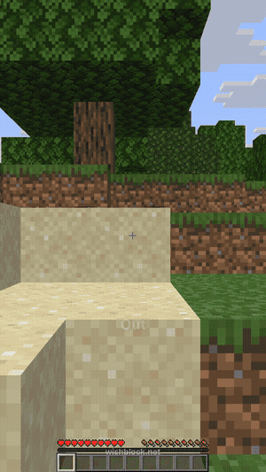

# /echest: open your ender chest anywhere

> **Typed into Wishblock:** *Make an /echest command that opens your ender chest anywhere*

([full clip](demo.mp4))

- `/echest`, `/ec` or `/enderchest` opens your own ender chest wherever you are, with the ender chest sound.
- Every player can use it; it only ever opens your own chest.

**Download:** [the jar](https://github.com/mc-chat-app/wishblock-plugins/releases/tag/echest-v1). It needs nothing but Paper 26.2; drop it in `plugins/` and restart.
It was loaded on a stock Paper 26.2 server (build 134) before it was published here.

**[Make your own version](https://app.wishblock.net/?wish=Make%20an%20/echest%20command%20that%20opens%20your%20ender%20chest%20anywhere&ref=github)**: opens Wishblock with this sentence already typed, so you can change it ("let ops open other players' ender chests"). Free, no download.

The code in this folder is what Wishblock's AI wrote for that sentence, as it was built and tested. See the [main page](../) for how it was made.

*Wishblock is not made by, endorsed by, or associated with Mojang or Microsoft.*
