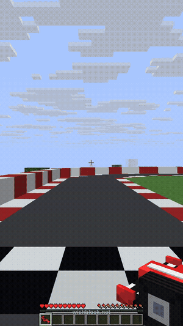

# Racecars for Minecraft

> **Typed into Wishblock:** *Add racecars I can drive and a racetrack*

([full clip](demo.mp4))

- `/racetrack` builds a big oval racetrack around you: curbs, walls and a checkered start line that times your laps.
- `/racecar [red|blue|green|yellow]` gives you a 3D racecar. Place it, right-click to get in, then W/S for gas and brake and A/D to steer.
- Crossing the line shows your lap time and your best lap.

Paper 26.2, Kotlin. The car models and textures are in `resources/pack/`.

**[Make this on your own server](https://app.wishblock.net/?wish=Add%20racecars%20I%20can%20drive%20and%20a%20racetrack&ref=github)**: opens Wishblock with this sentence already typed. Free, no download.

The code in this folder is what Wishblock's AI wrote for that sentence, as it was built and tested. See the [main page](../) for how it was made.

*Wishblock is not made by, endorsed by, or associated with Mojang or Microsoft.*
