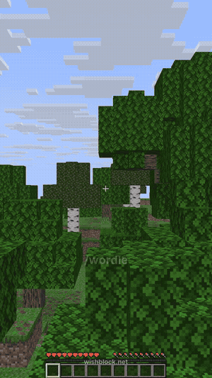

# Wordle in Minecraft

> **Typed into Wishblock:** *Make a wordle gui*

([full clip](demo.mp4))

- `/wordle` opens a Wordle board in a chest menu.
- Click **Make a guess** and type a 5-letter word in chat. Tiles turn green (right spot), yellow (wrong spot) or gray.
- Six tries. The **Letters** book shows every letter you have used, and **New word** starts over.

Paper 26.2, Kotlin. The letter tiles are custom textures in `resources/pack/`; the word lists are `resources/answers.txt` and `resources/valid.txt`.

**[Make this on your own server](https://app.wishblock.net/?wish=Make%20a%20wordle%20gui&ref=github)**: opens Wishblock with this sentence already typed. Free, no download.

The code in this folder is what Wishblock's AI wrote for that sentence, as it was built and tested. See the [main page](../) for how it was made.

*Wishblock is not made by, endorsed by, or associated with Mojang or Microsoft.*
